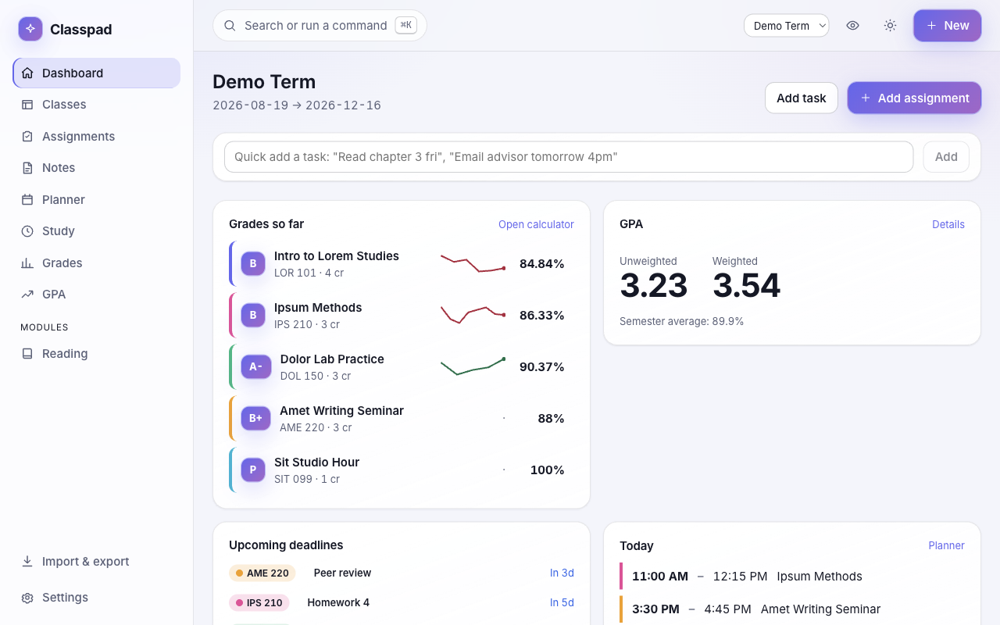
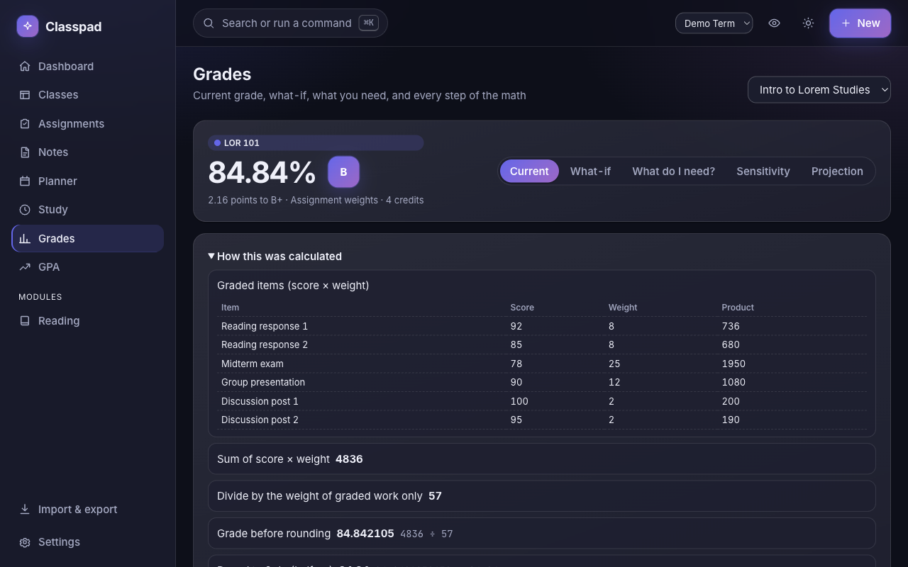

# Classpad

A calm, fast, open-source student workspace that runs entirely on your machine: classes,
assignments, a serious grade calculator, Markdown notes, and a planner. Local-first, no accounts,
no telemetry, no network calls.

> Status: first public release candidate. Everything below is built and tested; builds are unsigned for now.




_Screenshots use the built-in demo data. Regenerate with `node scripts/screenshots.mjs`._

## What's in it

- **Grades you can trust**: exact-decimal engine, three grading modes, step-by-step "how was this calculated", what-if, "what do I need?", GPA planner. See [docs/GRADING.md](docs/GRADING.md).
- **Notes** as real Markdown files with math, wiki links, backlinks, templates and a PDF viewer.
- **Planner**: timetable, calendar, tasks, workload heatmap, study timer and stats.
- **Import** from a Notion export, CSV, ICS, Markdown or a JSON backup, with preview and undo. See [docs/NOTION_IMPORT.md](docs/NOTION_IMPORT.md).
- **Optional modules** (off by default except Reading): journal, contacts, activities, jobs & internships, admissions, budget, flashcards with spaced repetition.
- **Bring your data in and out**: gradebook CSV import, declarative [plugins](docs/PLUGINS.md) for other layouts, and a one-way export folder for your other apps.
- **Privacy**: no network, no telemetry, no accounts. Optional app lock and encryption at rest ([SECURITY.md](SECURITY.md)).

More: [architecture](docs/ARCHITECTURE.md) · [data format](docs/DATA_FORMAT.md) · [good first issues](docs/GOOD_FIRST_ISSUES.md) · [changelog](CHANGELOG.md)

## Develop

```bash
npm install
npm test
npm run typecheck
npm run lint
```

## Run it

```bash
npm run dev       # API + web UI in your browser (http://127.0.0.1:5173)
npm run dev:stop  # stop leftover dev servers if a port is busy
npm run desktop   # the Electron desktop app
npm run e2e       # end-to-end tests on the built app
```

See `docs/PACKAGING.md` for installers and releases.

## Layout

- `packages/grades` – pure, exact-decimal grade and GPA engine
- `packages/jsonstore` – standalone atomic JSON/Markdown storage engine
- `packages/shared` – Zod schemas and shared types
- `packages/server` – local Fastify API
- `packages/importers` – Notion/CSV/ICS/Markdown importers
- `apps/web` – React UI · `apps/desktop` – Electron shell
- `fixtures/synthetic` – generated fake data (public)

Your own data never belongs in this repo: `private-fixtures/` is gitignored and a guard
(`npm run guard`) blocks private exports from being committed.

Licensed under MIT.
