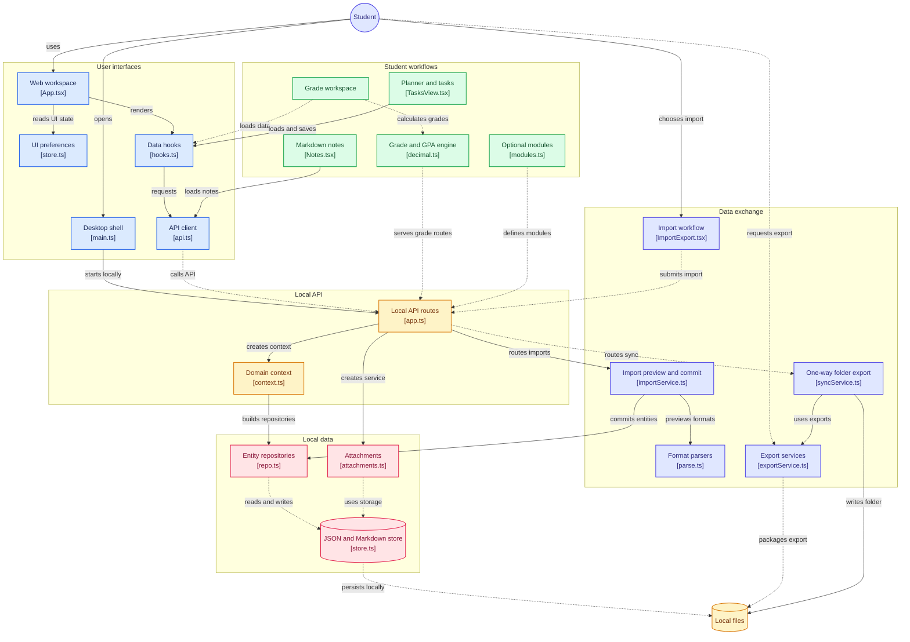

# Architecture

Classpad is an Electron app that talks to a small local web server inside the same process tree.
There is no cloud component.

```
┌─────────── Electron main ───────────┐      ┌────────── Renderer (sandboxed) ─────────┐
│ window, menu, single-instance lock  │      │ React UI (apps/web)                      │
│ starts the API on 127.0.0.1:<port>  │◀────▶│ fetch → http://127.0.0.1:<port>/api/v1    │
│ per-launch bearer token             │ IPC  │ preload bridge: token, port, native menu │
│ blocks every non-local request      │      │ no Node, contextIsolation, sandbox       │
└──────────────┬──────────────────────┘      └─────────────────────────────────────────┘
               │ in-process
       ┌───────▼────────┐   ┌────────────┐   ┌───────────┐   ┌────────────┐
       │ packages/server│──▶│ jsonstore  │   │  grades   │   │ importers  │
       │ Fastify routes │   │ files, I/O │   │ pure math │   │ pure parse │
       └───────┬────────┘   └────────────┘   └───────────┘   └────────────┘
               └── shared: Zod schemas, types, SRS, front matter, wiki links
```

## Packages

| Package              | Responsibility                                                                                                                     | Depends on        |
| -------------------- | ---------------------------------------------------------------------------------------------------------------------------------- | ----------------- |
| `packages/grades`    | Exact-decimal grade and GPA engine with step breakdowns. No I/O.                                                                   | decimal.js        |
| `packages/jsonstore` | Atomic JSON/text files, validation, migrations, backups, quarantine, watcher, encryption. Knows nothing about Classpad's entities. | adm-zip, chokidar |
| `packages/shared`    | Entity schemas (Zod), enums, ULIDs, SM-2 scheduling, cloze extraction.                                                             | zod               |
| `packages/importers` | Pure functions: Notion/CSV/ICS/Markdown/JSON in → `ImportPreview` drafts out. No file or network access.                           | shared            |
| `packages/server`    | Fastify API, repositories, search index, import/export services, app lock.                                                         | all of the above  |
| `apps/web`           | React 18 + Vite UI, TanStack Query, Zustand for UI preferences.                                                                    | —                 |
| `apps/desktop`       | Electron main + preload, packaging.                                                                                                | server, web       |

## Ideas that shape the code

- **The disk is the database.** Repositories keep an in-memory map and write through to files. A file
  watcher reloads hand edits (after validating them) and publishes an event over SSE, so the UI refreshes.
- **Every request is authenticated and local.** The API binds to loopback, requires a random bearer
  token created at launch, and rejects unexpected `Host` headers. While the app lock is on, everything
  except lock status/unlock returns `423 LOCKED`.
- **Errors have one shape**: `{ "error": { "code", "message", "requestId" } }`. Logs never contain
  note, journal or grade content.
- **Imports are drafts first.** Importers return previews with an `importRef` per item; committing
  writes a manifest so the whole import can be undone, after a pre-import backup.
- **Explainable numbers.** The grade engine returns steps as data; the UI renders them.
- **No network by design.** The Electron session cancels any request that is not the local server.

## Extension boundary

Classpad has no plugin system in v1. The supported seams for contributors are:

1. **A CSV format**: write a JSON mapping plugin (no code, see [PLUGINS.md](PLUGINS.md)). This is the supported way for users to extend importing.
2. **An optional module**: add a Zod schema in `packages/shared/src/modules.ts`, a repository line in
   `packages/server/src/context.ts` and routes in `app.ts`, then a definition in
   `apps/web/src/lib/modules.ts`. The generic table page handles the rest.
3. **An importer**: add a pure parser in `packages/importers` that returns `ImportPreview` drafts.
4. **A grading mode or GPA scale**: `packages/grades` (schemes and presets) with golden tests.

Anything that needs network access, accounts or sync is out of scope for v1.


## Diagram


